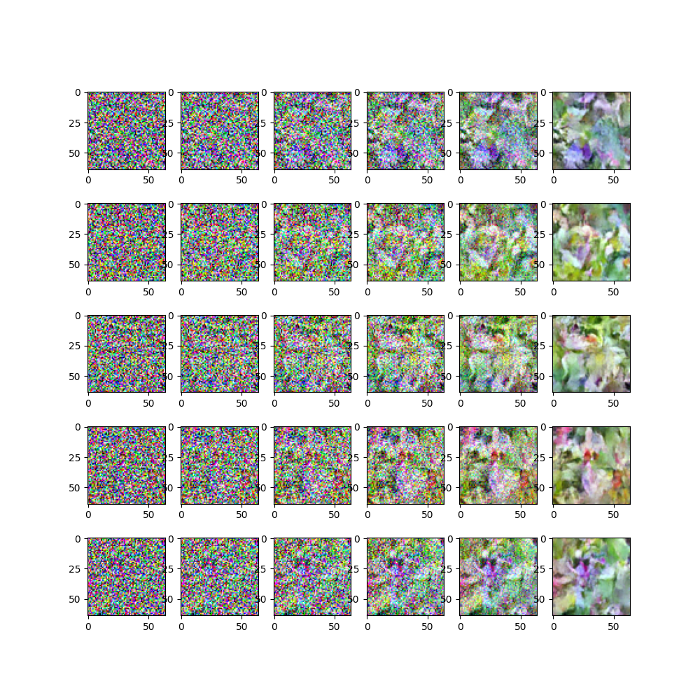

# diffusion-model-from-scratch

Image generation of flowers using a diffusion model and a time conditionned U-net, implemented and trained from scratch.

*4 flowers generated by the model with 50 sampling steps.*

## Dataset

Oxford 102 flowers (use all 8189 images), resized to 64x64.

## Brief description of the model

The model use the basic principle of predicting the noise added to an image at a random timestep.

The forward process uses the cosinus noise schedule: 

$x_t=\cos(t \pi /2)x_0+\sin(t\pi /2)\varepsilon$,

where $\varepsilon \sim \mathcal{N}(0, I)$.

For the denoising process, we use a U-net architecture with residual blocks and skip connections (hidden_channels=[64, 128, 256, 512]).

We also use the sinusoidal time embeddings, injected into every residual block.

## Training result

The training loop was run with 50 epochs, batch size=128, using AdamW optimiser with learning rate=2e-4 on Colab T4 GPU

The training took more than 2 hours. The final loss is 0.076

## How to run

Open [`diffusion.ipynb`](diffusion.ipynb) in Google Colab with a GPU runtime and run all cells.

## References

-Foster, D. (2023). Generative deep learning: Teaching machines to paint, write, compose, and play (2nd ed.). O’Reilly Media.

-Jonathon Ho et al., “Denoising Diffusion Probabilistic Models,” June 19, 2020, https://arxiv.org/abs/2006.11239

-Hugging Face "Annotated Diffusion", https://huggingface.co/blog/annotated-diffusion.